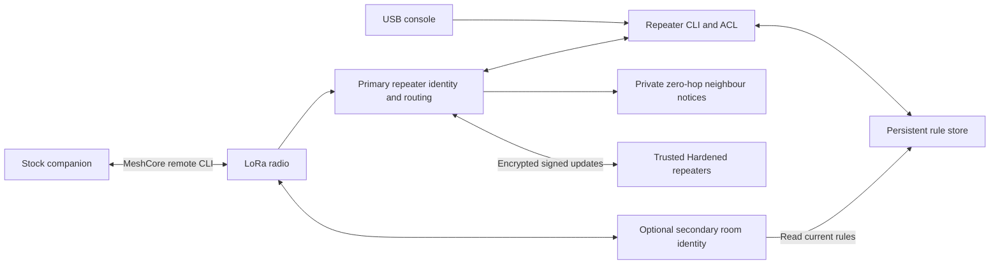
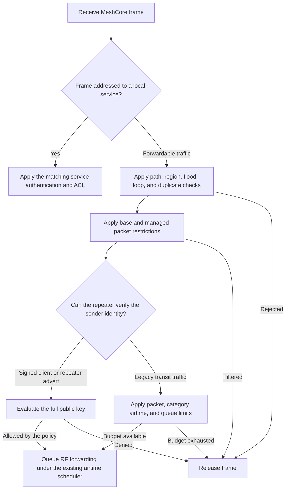
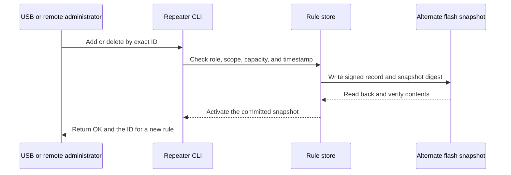
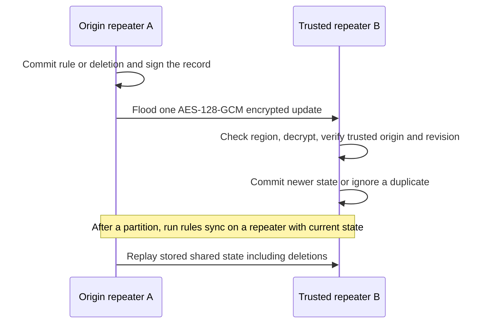

# MeshCore Hardened


*Project goal.* This diagram shows the intended network and administrator experience. See [validation status](#validation-provenance-and-license) for what has been verified on hardware.

MeshCore Hardened is repeater firmware for LoRa MeshCore networks. It retains the SaveMeshcore packet filters and adds persistent per-key rules, private direct-neighbour notices, encrypted policy synchronization between trusted repeaters, and an optional read-only administration room. Run official MeshCore firmware on your companion radios.

> [!IMPORTANT]
> A public-key blacklist can block a signed advertisement and restrict services addressed to this repeater. A stock private-channel text packet lacks a sender identity that a transit repeater can verify. In the bench run, the RAK3401 stopped forwarding the blacklisted M5's signed advert and continued forwarding its private group text. Use the channel filters, packet policies, and category budgets for traffic without a verifiable sender.

## AI-Assisted Development Declaration

This work was developed with the assistance of AI tools under the supervision of its authors and contributors.

AI-assisted implementation was subject to human direction, review, correction, and validation. The authors and contributors retain responsibility for their respective contributions, design decisions, quality control, and final approval of the work.

## Contents

- [Install and configure](#install-and-configure)
- [What the repeater does with a packet](#what-the-repeater-does-with-a-packet)
- [Base filters and enforced settings](#base-filters-and-enforced-settings)
- [Persistent rules and remote administration](#persistent-rules-and-remote-administration)
- [Private direct-neighbour notices](#private-direct-neighbour-notices)
- [Share signed rules between repeaters](#share-signed-rules-between-repeaters)
- [Optional administration room](#optional-administration-room)
- [Troubleshooting](#troubleshooting)
- [Build and release](#build-and-release)
- [Validation, provenance, and license](#validation-provenance-and-license)

## Install and configure

1. Identify the exact board and firmware target. For example, `RAK_3401_repeater` is the RAK3401 with the 1 W radio kit. The RAK4631 has a separate target. Use the board documentation or application USB identity to confirm the hardware. Some devices report a different model name in bootloader mode.
2. Get the matching firmware and `SHA256SUMS.txt` from the [project releases](https://github.com/WarDaddyLT/MeshCore-Hardened/releases). If no release is listed, use the [release workflow or target build instructions](RELEASE.md). Check your downloaded file's SHA-256 against its entry. With the whole release folder downloaded, run `shasum -a 256 -c SHA256SUMS.txt`.
3. Back up your settings or recovery material before changing firmware. Choose the board's application update procedure to retain its identity and settings. A factory erase clears the stored state on the erased partition.
4. Flash the matching application image. An nRF52 board may accept UF2 or a serial DFU ZIP. ESP32 has an application BIN for a matching existing partition layout and a merged BIN for initial installation. The release guide lists the formats for all board families. The [MeshCore flasher](https://flasher.meshcore.io/) provides board-specific flashing controls, including custom firmware where supported.
5. Open the repeater's USB serial console at **115200 baud** and send commands with a carriage return. In a terminal app, choose CR or CRLF for the line ending. Confirm the serial port from the application after flashing.

A first inspection over USB is read-only.

```text
ver
get name
get public.key
get radio
get repeat
filter
rules status
rules drops
neighbours status
rules sync status
get admin.enabled
```

`get radio` returns frequency, bandwidth, spreading factor, and coding rate. Match the intended MeshCore network preset and configure permitted transmit power for your hardware and operating band. `set name <node-name>` sets the advertised name. `get repeat` reflects the saved forwarding setting. Use `set repeat on` to enable forwarding, or `set repeat off` to stop it. The USB console remains your recovery path. `advert.zerohop` sends a one-off local advert. `advert` sends a one-off flood. Follow the stock CLI reference for radio settings, region management, and basic diagnostics. [MeshCore CLI reference](docs/cli_commands.md)

## What the repeater does with a packet

The same physical radio handles stock MeshCore forwarding, encrypted management addressed to the repeater, and optional Hardened messages. The primary key is the normal repeater identity. The optional room serves current rule state through a separate key.





The diagram shows the checks that apply, as distinct packet paths run some checks in different orders. For example, the MeshCore advert handler verifies signed flood adverts before passing them to the identity check. Packets bound for a local service are handled separately from transit packets. Forwarding copies at other repeaters and direct reception by nearby radios remain possible even when this repeater drops a frame.

| Traffic | What this repeater can use |
| --- | --- |
| Signed MeshCore client or repeater advert | The full Ed25519 public key and a verified signature. |
| Management addressed to this repeater | MeshCore's existing shared-secret transport and ACL role. A deny rule for the matched client also applies. |
| Group text and group data crossing this repeater | Packet class, path, region, rate, and recognizable Public-channel traffic. A channel key is shared by its members. |
| Anonymous requests and ordinary direct transit traffic | Routing and packet policies, including independent RF airtime budgets by category. |
| Hardened policy updates | An authenticated encryption tag, an Ed25519 signature from a provisioned origin, and domain, scope, rule ID, and revision checks. |

`rules drops` reports filter, identity, packet-rate, airtime, and queue drops since boot. `rules drops <category>` shows RF airtime and queue drops, plus estimated airtime admitted to the queue for that category. Use the stock `stats-packets` and `stats-radio` USB commands and matching RF path evidence to confirm transmissions.

## Base filters and enforced settings

The base settings persist independently of the rule store in `/savemesh_prefs`. Upgrades can import older SaveMeshcore filter settings from `/prefs.json`. A saved `filter data off` survives reboot and upgrade.

| Filter | Fresh default | Effect when on |
| --- | --- | --- |
| `1byte` | Off | Drops already-forwarded floods using 1-byte path hashes. A zero-hop flood, a direct packet, and wider flood paths can still pass the other checks. |
| `data` | On | Drops group data `0x06`, reserved unsigned types `0x0C` through `0x0E`, and raw custom packets `0x0F` at the forwarding filter. |
| `public` | Off | Drops group text and data that match the stock Public channel. It checks the Public channel hash byte and verifies the channel's 2-byte MAC. |

Run `filter` to see all three base settings or `filter <name>` to read one. Set any of them with `filter <name> on` or `filter <name> off`. For example:

```text
filter
filter 1byte on
filter data off
filter public on
filter public
```

The Public filter's MAC is calculated with the published Public-channel key. A different channel with the same hash byte normally passes the MAC check. The 16-bit tag permits a false match, about one in 65,536 candidate packets under the usual MAC assumption. The message body stays encrypted during this check.

| Stock setting | Hardened value or allowed range |
| --- | --- |
| `path.hash.mode` | `1` for 2-byte or `2` for 3-byte path hashes. A saved `0` is repaired to `1`. |
| `multi.acks` | `1`, one extra multi-ACK alongside the normal ACK. |
| `loop.detect` | `minimal`, `moderate`, or `strict`. A saved `off` is repaired to `minimal`. |
| `advert.interval` | `0`, disabling periodic zero-hop self-adverts. |
| `flood.advert.interval` | `0` to disable or `47` to `168` hours. A saved `1` through `46` is raised to `47`. |

Read these using `get <setting>` and change them using `set <setting> <value>`. The firmware checks them at boot before scheduling adverts and rejects out-of-policy CLI changes. [Base filter reference](docs/repeater_filter_cli.md)

## Persistent rules and remote administration

### Who can issue commands

The physical USB console can administer the device. The primary repeater supports the existing MeshCore remote CLI and its stock ACL. Grant permissions using the companion's complete, 64-hex-character public key. The public key is the ID shown by the companion, separate from the human-readable device name. On the repeater, `get public.key` prints its own key.

```text
get acl
setperm <companion-public-key> 3
```

Use **Access control** in the MeshCore USB web configurator or `setperm` over the USB console to approve a key directly. In Normal, the stock remote login can also enroll a key using a configured admin password. Set it with `password <new-password>` or leave it unset for key-only access. Legacy Restricted blocks password-based enrollment. An enrolled key can still log in with an empty password where the client permits it. Use `get acl` over USB to inspect roles and `setperm <companion-public-key> 0` to revoke one. In Normal, rotate or clear the enrollment password if the revoked operator knows it. Browser and Android checks on hardware remain pending.

| Existing ACL role | Hardened access over the primary repeater CLI |
| --- | --- |
| Guest `0` | Ordinary guest permissions apply. |
| Read-only `1` | Rule inspection, counters, and sync status. |
| Read-write `2` | Rule inspection, counters, and sync status. |
| Admin `3` | Rule changes, local mode and rate changes, explicit sync requests, neighbour inspection, and room contact inspection or export. |

Provision sync trust and keys, change notification keys, reset the neighbour table, and enable or rename the room from USB. Where enabled, the unauthenticated repeater Ethernet console exposes read-only `eth.status`, `ver`, and `board`. Notification channel members have ordinary channel membership. The channel provides no CLI entry point.

### Add, inspect, and remove rules

Replace bracketed or angle-bracketed placeholders with real values. Type a scope only when needed. The default scope is `local`.

| Command | Effect |
| --- | --- |
| `rules status` | Shows revision, active and deleted entry counts, capacity, mode, rate, and airtime share. |
| `rules count` | Returns the number of active rules. |
| `rules list [cursor]` | Returns one active rule with `next=<cursor>`. Keep passing the returned cursor until `End`. |
| `rules show <id-or-prefix>` | Shows a specific active rule. |
| `rules add allow client <public-key> [scope]` | Allows an attributable companion identity. It can also enroll that identity for direct-neighbour notices. |
| `rules add deny client <public-key> [scope]` | Blocks attributable activity for that companion. |
| `rules add allow repeater <public-key> [scope]` | Allows signed repeater adverts under restricted policy. Sync trust is configured separately. |
| `rules add deny repeater <public-key> [scope]` | Blocks the signed repeater identity and prevents acceptance of further sync updates it originated. |
| `rules device <client\|repeater> <public-key>` | Shows the effective trust decision and recent signed advert counts for a full key. |
| `rules add filter <1byte\|data\|public> <on\|off> [scope]` | Adds a scoped filter decision. |
| `rules delete <id-or-prefix>` | Removes the selected rule and retains its deletion record. Delete shared rules on their originating repeater. |
| `rules mode [normal\|protected\|locked\|restricted]` | Reads or selects the forwarding mode. Protected applies the 72-hour probation. Locked permits verified, explicitly allowed client and repeater transit. |
| `rules freeze [start [minutes]\|extend <minutes>\|end]` | Reads or controls the local enrollment freeze independently of forwarding mode. |
| `rules rate <0–600>` | Sets an independent packet count limit per minute for each of group text, group data, and anonymous requests. Use `0` to disable this cap. |
| `rules traffic type <id>` or `rules traffic category <name>` | Read or change local per-type and category forwarding policy. Actions are `allow`, `drop`, and `limit <packets-per-minute>`. |
| `rules airtime [0–100]` | Reads or sets the percentage of the configured radio duty cycle that each RF forwarding category may use over time. Defaults to 25%. Use `0` to disable the per-category airtime share. |
| `rules drops [category]` | Shows overall drops or airtime and queue statistics for one category. |

For a controlled blacklist check:

```text
rules status
rules add deny client <client-public-key>
rules list
rules show <rule-id>
rules drops
rules delete <rule-id>
rules list
```

Record the **32-hex-character rule ID** from `OK <id>`, then use that value in `show` or `delete`. Short prefixes require at least eight hex characters and must identify one record across both active rules and deletions. Repeating a delete on a known deletion is idempotent. Legacy messages can still cross the repeater while a client rule is active.

A **deny** wins over **allow** for the same attributable key, including when the key advertises a different role. An **allow** applies to its specified role. Normal is the default and permits unknown identities that pass the other checks. Upgrades load saved `open` as Normal and keep saved `restricted` active. Legacy Restricted requires an explicit allow for signed client and repeater adverts. Existing non-guest ACL identities can still use management addressed to this repeater unless denied. An allow rule alone gives no CLI role. Recent activity counts are kept in RAM and never change trust.

For managed filters, priority is local, then regional, then global. At the same scope the numerically higher revision wins, with the origin key breaking ties. A managed `off` removes the restriction from the winning managed rule. The effective forwarding filter stays on if the independently persisted base filter is on. Use the base `filter` command to change that setting.

The following commands add a local managed restriction, enable legacy restricted identity policy, and limit group text, group data, and anonymous requests to 30 forwarding candidates per minute each. To return to Normal with the added packet cap disabled, use `rules mode normal` and `rules rate 0`. Remove the example filter using the ID returned by its add command.

```text
rules add filter public on local
rules mode restricted
rules rate 30
rules status
```

### Flash storage and limits



Rules have a random 128-bit ID, a revision, a subject, a scope, an issuer, and a signature made by the originating repeater. The store alternates between `/hardened_rules_a` and `/hardened_rules_b`. It verifies the written copy before acknowledging a change and selects the newest valid snapshot at boot. The stored management timestamp for a remote writer also prevents replaying older successful mutations after reboot. There are eight remote-writer timestamp slots.

The **24-entry** capacity includes active rules and deletion records. Deletion retains the existing slot so an old shared copy cannot resurrect the rule. When full, the firmware rejects new entries. Existing entries can still be deleted, with their slots retained. `rules status` shows the local store revision, which also advances for configuration changes and incoming shared updates. Confirm delivery by inspecting the receiving repeater.

## Private direct-neighbour notices

1. Generate a fresh private 16-byte key, for example with `openssl rand -hex 16`.
2. Create a private channel on the companion with that same 32-hex-character key. Give the channel any recognizable label.
3. From the repeater USB console, provision the key and, for a companion you wish to detect, enroll the companion's public key.

```text
neighbours channel <private-channel-key>
rules add allow client <companion-public-key>
neighbours status
```

4. From the companion, send one **zero-hop advert**. Use `neighbours show 0` to inspect the first observation, and increment the index for additional observations. The lookup returns the device class, full public key, and the repeater clock's last-seen timestamp.
5. Read the group notice on the configured channel. It includes the observed device class and the first six bytes of the key. With a usable default transport region the notice uses that region. Otherwise it is sent zero-hop.

The observation must come over RF, pass signed-advert processing, and have no recorded hops. Repeater adverts qualify under the current policy. Client adverts require an allow rule and are suppressed by a deny. The RAM table deduplicates up to 32 identities per observation epoch. A reboot, `neighbours reset`, or a channel-setting command starts a new epoch. The sender queues at most one notice every five minutes and waits for an empty radio outbound queue. `pending=0` describes the local queue. Check the companion's channel to confirm delivery.

Use `neighbours status` for `channel`, `observed`, and `pending`. Use `neighbours channel off` to disable notices. Share the channel key only with intended recipients. A captured signed advert replayed nearby can still appear to have zero recorded hops. The observation records the received RF frame and its route metadata, which cannot establish geographic distance.

## Share signed rules between repeaters

Policy sync is opt-in. For repeaters A and B, read each primary public key with `get public.key`. Generate a dedicated 16-byte sync key and provision it on both devices over USB. Give both devices the same domain name.

On A:

```text
rules domain lab
rules sync.key <shared-sync-key>
rules trust <repeater-B-public-key>
rules sync status
```

On B:

```text
rules domain lab
rules sync.key <shared-sync-key>
rules trust <repeater-A-public-key>
rules sync status
```

Domain and region names accept 1–15 lowercase letters, digits, underscores, or hyphens. There are eight peer key slots. Use the full key for `rules trust` and `rules untrust`. The shared symmetric key gives authorized members access to encrypted policy frames. Each receiving repeater also verifies the Ed25519 signature against the provisioned origin key. Changing the domain or region is blocked while that name is used by stored rules or deletion records.

| Scope | Where the rule can travel |
| --- | --- |
| `local` | The originating repeater only. |
| `global:lab` | Trusted Hardened repeaters in the configured domain that can receive the unscoped policy flood. Check that the stock wildcard region allows flood traffic for this scope. |
| `region:labnorth` | Trusted Hardened repeaters with the same domain and configured policy region, reached over the matching stock region transport. |

For a regional deployment, use the same matching region in each repeater's stock region map and allow floods in it. Example USB commands:

```text
region put labnorth
region allowf labnorth
region save
rules region labnorth
```

On the originating repeater, issue a shared rule and retain its ID.

```text
rules add deny client <client-public-key> global:lab
rules sync status
rules sync
```

Shared writes queue sync automatically. The explicit `rules sync` command requeues the stored shared rules and deletions. Transmissions are limited to one queued update per minute and wait for the outbound queue. A region with no usable transport key is skipped. Check `rules list` or `rules show <id>` on the receiving device to confirm receipt. To remove a shared rule, delete its ID on the original repeater, then verify the peer no longer lists it.



The policy record is signed with Ed25519 and bound to its origin, domain, and scope. The radio packet carries one record in a Hardened control frame, encrypted with AES-128-GCM using a 12-byte nonce and 12-byte authentication tag. A short origin prefix selects candidate keys. Only full signature verification authorizes the record. Peers reject stale updates to a known rule and retain signed deletion records to prevent resurrection. A repeater that already has an update does not re-flood it on receipt. For a multi-hop repair, run `rules sync` on intermediate trusted repeaters holding current state. Stock repeater interoperability for ordinary traffic is separate from participation in this sync protocol.

`rules sync.key off` disables sync without deleting accepted rules. `rules untrust <peer-key>` blocks later updates from that signer. Previously accepted state remains until the applicable policy changes. An offline repeater can continue using its last accepted policy during a partition.

## Optional administration room

The room defaults off. Enable it only when you are ready to check the experimental room workflow. Android contact import, login, and reply display are still pending validation. The primary identity continues handling normal repeater forwarding and management.

| Command | Effect |
| --- | --- |
| `get admin.enabled` | Reports whether an enabled secondary identity is available. |
| `set admin.enabled on` | Creates a separate persistent keypair on first use and enables its service. USB only. |
| `set admin.enabled off` | Stops the room service. USB only. |
| `get admin.name` | Shows the custom name or the default based on the repeater name plus `Admin`. |
| `set admin.name <short-name>` | Sets a valid MeshCore advert name of at most 31 bytes. USB only. |
| `get admin.pubkey` | Prints the secondary identity's full public key. |
| `get admin.advert` | Starts or reuses a five-minute signed contact export. Returns transfer ID, part count, byte count, and SHA-256. |
| `get admin.advert <index>` | Returns a zero-based chunk of up to 48 bytes as hex. |
| `admin.advert once` | Queues a single zero-hop room advert. The on-demand advert has a one-minute cooldown. |

For setup, provision the desired companion's existing ACL role using the USB console. Then enable and name the room.

```text
setperm <companion-public-key> 1
set admin.name Lab Admin
set admin.enabled on
get admin.pubkey
get admin.advert
```

Retrieve parts from `0` through `parts - 1` within five minutes. Compare the transfer ID on all parts, append only their hex bodies in index order, decode the result, and check its byte count and SHA-256 against the original response. The upstream signed card convention is `meshcore://<combined-hex>`. If your client supports that format, try importing the card. For a local RF test, issue `admin.advert once` and receive it on the companion. The repeater sends no periodic room adverts.

Open the **secondary room contact** and use native room login with an empty password and the previously enrolled ACL identity. Send one of these as room text:

```text
rules count
rules status
rules list
rules list 1
rules show <rule-id>
```

Use the cursor in the actual reply when paging. The adapter keeps up to eight in-memory room sessions with a five-minute idle lifetime and a shared two-second reply interval. It returns current rule data on demand. All changes go through the authenticated **primary repeater CLI** or USB. The room does not store posts, replies, or chat history, although a companion app may keep its own local copies.

## Troubleshooting

| Symptom | What to check |
| --- | --- |
| Nothing forwards | Check `get repeat`, the RF preset on both ends, region flood permissions, `filter`, and `stats-packets`. Use `set repeat on` only where you intend the repeater to forward. |
| The blacklisted device is still audible | Check the packet class and actual path. Nearby recipients can hear a direct transmission, other repeaters may route it, and legacy transit text has no verifiable per-sender key. |
| A remote rule command is rejected | Confirm the primary contact and ACL role over USB. Shared writes require the admin role. A writer's command timestamp must advance. |
| An ID prefix is ambiguous | Use the complete 32-hex-character rule ID returned by the add command. |
| Rule storage is full | Check `active`, `deleted`, and `capacity` in `rules status`. Deletions deliberately retain their slots. |
| Rule storage is unavailable or forwarding is held | Run `rules recovery` over USB. A missing or corrupt committed policy blocks forwarding. Recover a readable revision or initialize empty policy on USB, review the policy, and then run `rules resume`. |
| No neighbour appears | Check the private channel is set, send a signed zero-hop advert over RF, enroll a client with an allow rule, check for a deny, and inspect `neighbours status`. |
| Peer does not receive a rule | Check the sync key, domain, region flood configuration, origin trust, and rule scope. Start `rules sync` and allow time for queued updates. Inspect state on the receiving peer. |
| Room does not answer | Verify the secondary contact, ACL membership, enabled setting, and session login. The normal USB and primary remote CLI remain the supported administration paths. |

Use `rules work`, `rules drops`, and the stock USB statistics commands for diagnostics. The repeater no longer creates a packet log on flash. Existing legacy logs can be erased with `log erase` over USB. [Additional CLI reference](docs/hardened-repeater-cli.md)

## Build and release

GitHub Actions builds the same set of **97 repeater targets** published by SaveMeshcore v1.18.0-savemesh.1. A tag such as `repeater-v1.18.0-hardened` starts the full matrix. After all boards build and their artifact checksums are verified, the workflow assembles a draft release for review. The build creates no device uploads. [Release, artifact formats, and local commands](RELEASE.md) · [SaveMeshcore target reference](https://github.com/aigarslv/SaveMeshcore/releases/tag/repeater-v1.18.0-savemesh.1)

```sh
# List all supported release targets
bash build.sh build-repeater-firmwares --list

# Check every target locally and keep going after failures
bash build.sh check-repeater-firmwares

# Build a single development firmware package
bash build.sh build-repeater-firmwares --version v1.18.0-hardened \
  --target RAK_3401_repeater
```

The local checker writes one log per board and `summary.txt` under `out/repeater-check/`. The full matrix is configured in GitHub Actions. Review the Actions run for the actual result of each board.

## Validation, provenance, and license

The RAK3401 development build compiled, flashed, and answered its Hardened USB CLI. The RF bench detected the enrolled ThinkNode M5. Signed advert forwarding was observed before the deny, blocked while the deny was active, and observed again after deletion. The RAK3401 also forwarded private group text throughout the trial.

The RF bench used the repeater USB console for administration after the T-Echo Lite Kit companion USB query failed. Stock Android room interoperability, remote administration in that bench, formal four-device RF validation, and multi-repeater policy convergence remain pending. The complete GitHub build matrix has yet to run. [Bench evidence and validation status](docs/implementation-plan.md)

MeshCore Hardened started from a pinned SaveMeshcore snapshot, which adds filters to MeshCore. It has its own Git history and release workflow. The source archive revision and checksum are recorded in the provenance note. Software is distributed under the repository [MIT license](license.txt), with bundled components carrying their own notices. Binary releases also need the applicable notices for the bundled code and build dependencies. [Source baseline and upstream attribution](docs/source-baseline.md)
